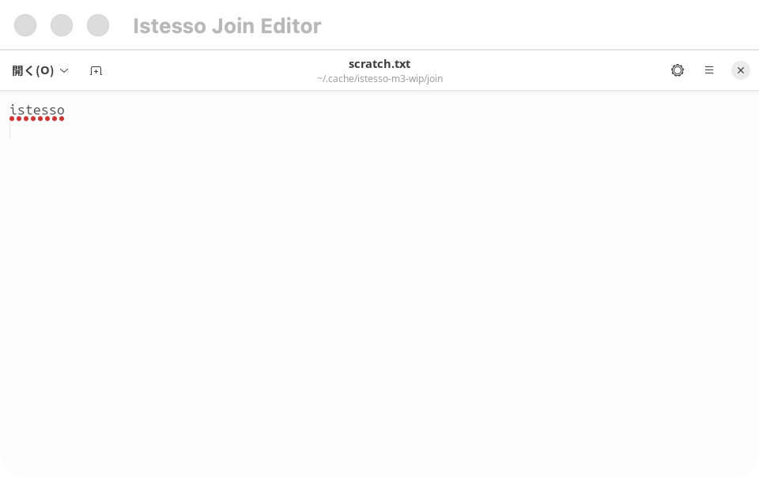

# 予行：M3（アプリマネージャー）と本線を合わせる

2026-11-17 未明の記録です。ブランチ `m3-join-rehearsal` は、`m1-local-cursor`（PR #8 まで）に `m3-app-manager`（PR #2）をマージしたもので、**どこにもマージしません**。ねらいは 2 つです。

- 2 つの流れが `main` に入るときに、何がぶつかるかを、先に知る。
- M3 の偽物（映像を運ばないランナーとビューアー）の代わりに、本物をつなぐ：Mac で `istesso open <アプリ>` を実行すると、Ubuntu のホストでアプリが起動して、暗号化した経路で、絵が窓に出る。

## 分かったこと

- 合わせられます。衝突は 7 ファイルで、どれも「両方が同じ場所に足した」形でした。両方の振る舞いを残して解けました。合わせたあと、両方のテスト（394 件）が、Mac と Ubuntu で通りました。
- **本物の絵が出ました。** `istesso open` から、ホストのテキストエディター（gnome-text-editor）が、M3 のエージェントの下で起動し、ADR 0015 の暗号化した経路で、Mac の窓に映りました。窓の入力の口から送ったキーが、そのセッションにだけ届き、アプリが保存したファイルに、打った文字が入っていました。離れて、同じコマンドで戻ることもできました。
- ランナーとビューアーの約束（ADR 0010）は、変えずに済みました。合わないところは、包み（`scripts/session-runner.py`、`scripts/session-viewer.py`）の側で受けて、下の一覧に書きました。いまのパイプラインにできないことが、4 つあります（離す、止める、戻す、閉じるよう頼む）。

（取り込んだのは、この確認のために開いた窓だけです。ポインターには触らず、窓を前面の操作対象にもしていません。）

## 手順 1：マージと、衝突

| ファイル | 衝突 | 合わせ方 |
|---|---|---|
| `crates/istesso-link/src/message.rs` | 両方が、`Request` の末尾に足した | 両方を残す。本線の入力が先 |
| `crates/istesso-agent/src/serve.rs`（リクエストのループ） | 本線：入力を受ける（`input_open`、`input`、流れているあいだの権限の確かめ直し、計測の記録）。M3：リクエストごとにペアリングの一覧を読む。セッションのリクエストを表に渡す。解除された端末には答えずに、接続を閉じる | 1 つのループに、両方を入れた |
| `crates/istesso-agent/src/serve.rs`（`answer`） | 「ここでは答えない」分岐 | 両方を残す |
| `crates/istesso-agent/src/survey.rs`（テストの代役） | 聞かれないリクエストの分岐 | 1 つにまとめた |
| `crates/istesso-cli/src/main.rs` | コマンド、オプション、振り分け | 両方を残す |
| `docs/adr/0007-control-channel.md`、`docs/architecture.md` | 更新の行、表の行 | 両方を残す |
| `Cargo.lock` | 依存 | 本線のものに、M3 の 2 つを cargo が足した |

衝突の相手は、ほとんどが PR #4（入力）の内容です。PR #7 に由来するのは、`architecture.md` の表の 1 行だけでした。衝突ではないが直したところ：M3 のテスト 2 か所に、本線の新しい設定項目（`input_timings`）。

## 決まりが食い違うところ（持ち主に決めてほしい）

予行では、きびしいほうを採りました。

| 事柄 | 本線 | M3（ADR 0010） | 予行で採ったもの |
|---|---|---|---|
| だれが、セッションに入力を送れるか | 「操作」を持つ端末なら、どれでも。ホストに 1 つの口へ | そのセッションを映している端末だけ | `input_open` がセッションを名乗ったときは、映している端末だけ。名乗らなければ、本線のまま |
| `input_open` の権限を、いつの時点のもので確かめるか | ハンドシェイクのとき（流れているあいだは、1 秒おきに読み直す） | リクエストが届いた時点の一覧 | 届いた時点の一覧 |
| だれが、絵を受け取れるか | 「閲覧」を持つ、ペアリング済みの端末なら、つないできたどれでも（ADR 0015） | 「閲覧」と「操作」を持ち、そのセッションにつないだ端末 1 台だけ | **採れていない。** パイプラインに、相手を選ぶ口がない。いまは本線のまま（下の「合わないところ」の 5） |
| ペアリングの一覧が読めないとき | 入力は止まる（結果として）。絵は、1 秒で止まる（ADR 0015） | だれにも答えない。絵を止める。印は付けない（ADR 0010 の 12） | 両方が効いている。決まりとして書いてあるのは、M3 の側だけ |

## 手順 2：本物のランナーとビューアー

- `scripts/session-runner.py`（ホスト）：エージェントから `start` を受けて、`scripts/m1-step3-host.py --to-channel <ポート> --cursor --input-socket <そのセッションの口>` を起動します。コンポジターのソケットの名前を読み取って、`ready` で、アプリの環境変数（`WAYLAND_DISPLAY` と `XDG_RUNTIME_DIR`）と、ビューアーへの答え（ポート）を返します。アプリを起動するのは、エージェントです（`DISPLAY` を外し、Wayland を選ばせる変数を足す。ADR 0010 の 8 の案のとおりで、GTK のアプリで初めて確かめました）。
- `scripts/session-viewer.py`（Mac）：`istesso open` から `show` を受けて、`macos/gst-viewer` を `ISTESSO_CHANNEL` 付きで起動します（シェルから。アプリのバンドルは、作りも、開きもしません）。となりで `istesso input relay --session <ID>` を起動し、窓の入力を、制御チャンネルでホストへ送ります。最初の絵が描かれたら、`shown` と言います。

### 入力を、セッションごとにするために変えたこと

これまでは、入力の口がホストに 1 つ（`$XDG_RUNTIME_DIR/istesso/input.sock`）で、映せるアプリは 1 つでした。

- `input_open` に、`session` を足しました（省けます。古い相手は、これまでどおりです）。
- エージェントは、セッションを名乗られたら、送り側が、そのセッションを映している端末かを確かめて、そのセッションの口（`input-<ID>.sock`。エージェントが `start` でランナーに渡したもの）へ渡します。映している端末でなくなったら、その時点で、渡すのをやめます。
- `istesso input relay` に、`--session <ID>` を足しました。
- パイプラインは、`--input-socket` で、口の場所を受け取ります（本線が、すでに作っていました）。

## 合わないところ（約束と、いまの本物）

| # | 約束（ADR 0010） | いまの本物 | 包みでの扱い |
|---|---|---|---|
| 1 | `detach`：そのクライアントへ送るのをやめ、決めたことを捨て、エンコーダーを手放す | パイプラインには、相手を切る口も、エンコーダーを閉じる口もない。ビューアーが終われば、受け取る相手はいなくなるが、ポートは開いたままで、エンコーダーも動いたまま | 受けて、「まだできない」と記録する |
| 2 | `pause`、`resume`：エンコーダーを閉じる、開き直す | 同上 | 同上 |
| 3 | `close`：窓に、閉じるよう頼む（`xdg_toplevel.close`） | コンポジターに、その口がない | 同上。アプリは閉じない |
| 4 | `empty`：最後の窓が閉じたら知らせる | 分からない | 知らせない。アプリのプロセスが終わったことは、エージェントが見ている |
| 5 | 絵は、`peer.address` へだけ送る | つないできた、ペアリング済みで「閲覧」を持つ端末なら、どれにでも送る | そのまま。上の「食い違うところ」 |
| 6 | `attach`：新しい `display` で送り始める | 絵の大きさは、セッションを始めたときのまま。つなぎ直した端末には、同じポートで送る | 同じ大きさで `attached` と答える |
| 7 | ビューアーの `close`：人が窓を閉じようとしたら、窓は閉じずに知らせる | 窓を閉じると、ビューアーが終わる | 「離れる」になる。アプリは動き続け、閉じるようには頼まれない |
| 8 | ビューアーの `hidden`、`visible`、`paused`、`resumed` | ない | `hidden` と `visible` は言わない。`paused` と `resumed` は、受けて記録するだけ |
| 9 | ビューアーが、望む `display` を、窓を出すディスプレイから決める | 包みは、ディスプレイを見ていない | 指定がなければ 1280x720、60 fps。窓の大きさは、絵の画素を 2 で割った点（設定で変えられる） |
| 10 | ポートは、ランナーが自分で選ぶ | 2 つのセッションが同時に始まると、2 つのランナーが、同じ空きポートを選んだ（パイプラインがポートを開くのは、数秒あと）。1 回目の確認で、片方が起動に失敗した | ランナーが、ポートごとのファイルに鍵をかけてから選ぶようにした。パイプラインが、空いているポートを自分で取って知らせる形のほうが、確かである |
| 11 | ランナーに渡す設定 | 約束にない（プラグインの場所、レジストリー、ライブラリー、使えるポート） | エージェントの環境変数から受け取る。エージェントの設定に入れる場所が要る |

そのほかに気づいたこと：

- Mac のソケットの場所は、104 バイトまでです。ビューアーの入力の口は、一時ディレクトリーの下に置きました。
- gnome-text-editor は、同じ人のデスクトップですでに動いていると、そちらに窓を出します。確認では、`--standalone --ignore-session` を付けました。1 つしか動かない作りのアプリは、ADR 0010 の 8 の「分かっている限界」のとおりです。
- ビューアーは、シェルから起動したので、優先度が低いままです。**遅延は測っていません。** 動くかどうかだけを見ました。

## 手順 3：実機 2 台での確認

`scripts/m3-join-trial.sh` が、次を通しで行います（30 秒ほど）。ホストでは、試験用のエージェントを、専用の tmux（`join-agent`）、専用のポート（47840。絵は 47841 から）、専用のキャッシュとソケットの場所で動かしました。ふだんのエージェント、ふだんの入力の口、持ち主の試用の窓には、触っていません。

| 確かめたこと | 結果 |
|---|---|
| `istesso open` で、ホストのテキストエディターが起動し、セッションが `running` になる | そのとおり |
| 暗号化した経路で、フレームが届き、復号されて、窓に描かれる | そのとおり |
| 窓の入力の口に書いたクリックとキー（i s t e s s o、Enter、Control-S）が、そのセッションに届く | アプリが保存したファイルが、「istesso」の 1 行 |
| 窓の取り込みに、打った文字が見える | 上の絵 |
| Ctrl-C で離れると、アプリは動き続け、一覧に「映っていない」と出る | そのとおり |
| 同じコマンドで、同じセッションに戻り、絵がまた描かれる | そのとおり（同じ文字が見える） |
| アプリを 2 つ、同時に開く。それぞれの窓の入力の口に、別の文字（one、two）を書く | それぞれのアプリのファイルに、その窓の文字だけが入っている。入力は、セッションごとに分かれて届く |
| 終わらせると、ホストにも Mac にも、何も残らない | そのとおり |

経路は、Mac の有線のアダプター、IPv4 です。

## 確かめていないこと

- 遅延、画質、音。
- 2 台めの端末から見ること。枠が足りないときの動き（本物では、止められない）。3 つ以上を同時に開くこと。
- ペアリングを解除したときに、絵の接続が切れること（ADR 0015 は、0.25 秒おきに読み直して切る、としています。ここでは試していません）。
- IPv6。カーソルを窓の側で描くこと（`--cursor` は付けましたが、ポインターに触らなかったので、見ていません）。
- 人の手での操作（実際のキーボードとマウス）。窓を操作対象にする必要があるので、朝に回しました。
- 起動してから絵が出るまでの時間。

## `main` に入れる順番（案）

1. PR #4（`m1-latency`）。持ち主の決定のとおり、最初。
2. PR #2（`m3-app-manager`）を、`main` に合わせ直す。衝突は、上の表のとおりで、この予行の解き方を、そのまま使えます。食い違いの表の 1 行目と 2 行目（入力の権限）は、ここで決める必要があります。
3. PR #7（暗号化した映像）、PR #8（カーソル）。M3 との衝突は、`architecture.md` の 1 行だけの見込みです。2 と 3 は、逆の順でも、衝突は変わりません。
4. そのあとで、この予行の中身を、別の PR にする：`input_open` の `session`（ADR 0007 を先に更新）、本物のランナーとビューアーの包み。
5. 包みが「まだできない」と記録しているもの（上の 1 から 5、7、8）を、映像の側で作る。ペアリングの解除の決まり（ADR 0010 の 12）からは、1 と 5 が先です。
