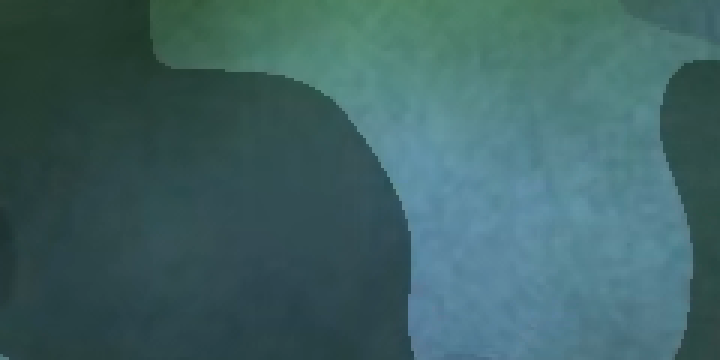

# 難しい絵（写真や動画に近い絵）：画質と遅延の参考値

- 日付：2026-11-16
- コミット：7ddaf0d（コードの変更なし。記録だけ）
- 目的：ビットレートの上限（30 Mbps。[ADR 0002](../adr/0002-latency-first.md)）を見直す材料を出す。判定の絵（動く文字）は 5 Mbps しか使わず、上限が効いていない。上限が効く絵で、画質がどこまで出るか、遅延がどれだけ延びるかを見る。**参考値で、判定には使わない。**
- 結論：**30 Mbps で、PSNR 39.8 dB、明るさの SSIM 0.94。150 Mbps まで上げても、41.7 dB と 0.96 で、伸びは小さい。遅延は、文字の絵より中央値で 0.9 ms、95 パーセンタイルで 1.5 ms 大きい。** 上限は 30 Mbps のままでよい、というのが案（決めるのは人）。

## 条件

| 項目 | 値 |
|---|---|
| ホスト | Ubuntu 24.04、RTX 4090（ドライバー 590.48.01）、GStreamer 1.24.2。有線（2.5 Gbps） |
| クライアント | MacBook Air（M4）、macOS 26.5.1。VideoToolbox で復号。遅延の計測にだけ使った |
| 接続 | 2 台とも有線（[有線の記録](2026-11-16-step3-cable.md) と同じ形。往復の中央値 0.6 ms、95% 1.0 ms） |
| 絵 | テストアプリの `--picture hard`、3440×1440、毎秒 85 枚。写真のような絵を 2 枚重ねて別々の向きに動かし、フレームごとに変わる細かいざらつき（±2 レベル）を足したもの。どの部分も、前のフレームをずらしては作れない |
| クライアントのディスプレイ | 外部（3440×1440、拡大なし）。**60.00 Hz**（ハブ経由。判定の条件ではない） |
| コーデック | H.265。4:4:4（Main 4:4:4）と 4:2:0（Main）、どちらも 8 ビット |
| エンコーダーの設定 | `preset=p1 tune=ultra-low-latency zero-reorder-delay=true b-frames=0 rate-control=cbr`。キーフレームは求められたときだけ。レート制御のバッファーは 1 フレームぶん |
| 経路 | 画質はホストだけ（どこにも送らない）。遅延は RTP を UDP で、暗号化なし |

## 画質（ホストだけ。`scripts/m1-quality.py --picture hard`）

20 秒ぶん（1,700 フレーム）を通し、あとの 10 秒を見た値です。

| 色 | 指定 | 実際 | いちばん大きいフレーム | 明るさの SSIM（平均 / 5% / 最悪） | 色の SSIM（平均 / 5% / 最悪） | PSNR |
|---|---|---|---|---|---|---|
| **4:4:4** | **30 Mbps** | 28.3 Mbps | 45 kB | **0.9395 / 0.9385 / 0.9377** | 0.9866 / 0.9864 / 0.9862 | **39.8 dB** |
| 4:4:4 | 60 Mbps | 54.5 Mbps | 83 kB | 0.9520 / 0.9512 / 0.9507 | 0.9882 / 0.9881 / 0.9880 | 40.8 dB |
| 4:4:4 | 100 Mbps | 88.9 Mbps | 138 kB | 0.9584 / 0.9578 / 0.9573 | 0.9892 / 0.9891 / 0.9890 | 41.3 dB |
| 4:4:4 | 150 Mbps | 133.1 Mbps | 202 kB | 0.9628 / 0.9623 / 0.9620 | 0.9899 / 0.9897 / 0.9897 | 41.7 dB |
| 4:2:0 | 30 Mbps | 28.1 Mbps | 46 kB | 0.9400 / 0.9390 / 0.9383 | 0.9817 / 0.9811 / 0.9808 | 39.8 dB |
| 4:2:0 | 100 Mbps | 89.0 Mbps | 136 kB | 0.9584 / 0.9578 / 0.9574 | 0.9869 / 0.9866 / 0.9864 | 41.3 dB |

同じ設定の文字の絵は、4.8 Mbps で、明るさ 0.9996、色 0.9990、47.7 dB でした。

絵の一部（240×120 ピクセルを 3 倍に拡大。フレーム 1530）：

| 送った絵 | 4:4:4、30 Mbps | 4:4:4、100 Mbps |
|---|---|---|
|  |  |  |

- **形と色は残り、細かいざらつきが均されます。** 30 Mbps では、ざらつきがほぼ消えて、粗い塊が見えます。
- **ビットレートを上げても、少ししか良くなりません。** 30 → 60 Mbps で +1.0 dB、60 → 100 で +0.5 dB、100 → 150 で +0.4 dB。フレームの大きさは、ビットレートに比例して大きくなります。
- **文字の絵の条件（明るさの SSIM が 0.99 以上）には、150 Mbps でも届きません。** この絵には、フレームごとに変わるざらつきが入っていて、これは前のフレームから作れません。ざらつきだけが全部消えて、ほかが完全に残ったとしても、PSNR は 45.1 dB にしかなりません。画質の条件は、文字の絵のためのもので、この絵には当てはめません。
- **4:4:4 と 4:2:0 で、明るさの画質は同じです**（同じビットレートで 0.9395 と 0.9400）。色は 4:4:4 のほうが良い（0.9866 と 0.9817）。この絵でも、4:4:4 にして失うものはありません。

## 遅延（Mac まで通した値。500 回、20:15〜20:20）

上限 30 Mbps、4:4:4。窓の置き方と測り方は、同じ晩の文字の絵の回（[有線の記録](2026-11-16-step3-cable.md)）と同じです。

| 指標 | 難しい絵（中央値 / 95% / 99%） | 文字の絵（中央値 / 95% / 99%） |
|---|---|---|
| **追加遅延の、手元の窓との差** | **11.95 / 12.64 / 14.70 ms** | 11.02 / 11.12 / 16.10 ms |
| 追加遅延（中継した窓） | 36.86 / 44.79 / 47.86 ms | 35.62 / 43.77 / 49.21 ms |
| 追加遅延（手元の窓） | 24.91 / 32.15 / 33.16 ms | 24.60 / 32.65 / 33.11 ms |

ディスプレイが 60 Hz なので、合格ラインとは比べません。2 つの絵の差を見るための値です。500 回なので、99 パーセンタイルは判断に使いません。

内訳（平均）：

| 区間 | 難しい絵 | 文字の絵 | 差 |
|---|---|---|---|
| ネットワーク（行きと帰り） | 1.18 ms | 1.03 ms | +0.15 ms |
| コンポジター | 1.88 ms | 1.86 ms | +0.02 ms |
| 色の変換と圧縮 | 4.06 ms | 4.06 ms | 0.00 ms |
| パケットにして渡す | 0.17 ms | 0.17 ms | 0.00 ms |
| **フレームが届く（最初のパケットから最後まで）** | **0.92 ms** | 0.20 ms | **+0.72 ms** |
| **復号** | **3.34 ms** | 3.08 ms | **+0.26 ms** |
| 復号してから、描くまで | 0.42 ms | 0.40 ms | +0.02 ms |
| 合計（中継のために足される区間） | 11.97 ms | 10.80 ms | +1.17 ms |

- 入力を映したフレームは、平均 41.9 kB、37 パケット（文字の絵は 7.7 kB、8 パケット）。実際のビットレートは 28.1 Mbps。
- **延びたのは、フレームが届くまでの時間と、復号です。** 圧縮の時間は変わりません。
- 途中でキーフレームを求めた回数は 0、パケットの欠けは 0 回。コンポジターを出たフレームは毎秒 84.9 枚。
- 始めのキーフレームの求めは、8 回のうち 7 回が送れませんでした（0.35 秒ぶん）。ビューアーを作り直した直後の最初の起動だったためで、macOS がローカルネットワークの許可を確かめ直すあいだ、送れません（[README.md](README.md) の「ローカルネットワークの許可」）。計測は、絵が出てから始めているので、値には入っていません。

カメラでの計測：行っていません。

## わかったこと

- **上限 30 Mbps は、文字の絵には効いていません**（5 Mbps しか使わない）。効くのは、写真や動画のように、画面の全部が毎フレーム変わる絵です。
- **そういう絵では、上限を上げても画質の伸びは小さく、フレームだけが大きくなります。** 60 Mbps にすると、画質は +1.0 dB、フレームは 2 倍（83 kB、約 70 パケット）。届くまでの時間がフレームの大きさに比例するとすれば、有線でも、さらに 0.7〜0.9 ms 延びます。復号も延びます。Wi-Fi では、もっと効きます。
- **30 Mbps のままでも、難しい絵の遅延は、文字の絵より 1 ms ほど大きいだけです。** 60 Hz のディスプレイで、中央値 12.0 ms でした。
- **案：上限は 30 Mbps のままにする。** 動画を見るための、画質を優先する設定（上限を上げ、遅延を少し譲る）は、要るようになったら、配信の種類として別に足す（R-02 の「配信の種類」）。決めるのは人です。
- この絵は、実際の使い方より厳しく作ってあります（ざらつきが毎フレーム変わる）。本物の動画や写真のスクロールでの値は、本物のアプリが動くようになってから測ります。

## 再現のしかた

- 画質：ホストで `python3 scripts/m1-quality.py --picture hard --size 3440x1440 --chroma 444 --gop -1 --bitrate 30000,60000,100000,150000`。切り抜きは `--crops <置き場所> --crop-frames 1530 --crop 400,300,240,120`。
- 遅延：[有線の記録](2026-11-16-step3-cable.md) の「再現のしかた」で、2 つのテストアプリに `--picture hard` を付ける。
