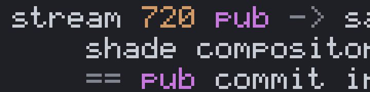
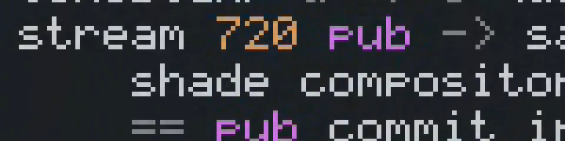
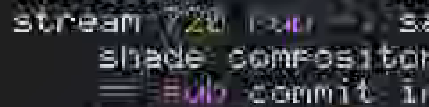
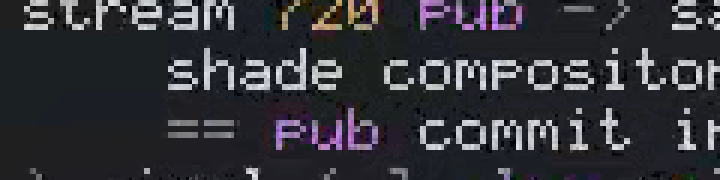
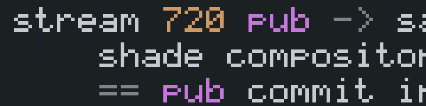
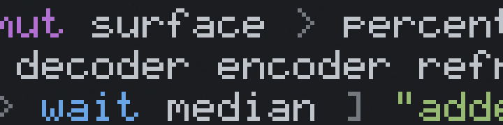
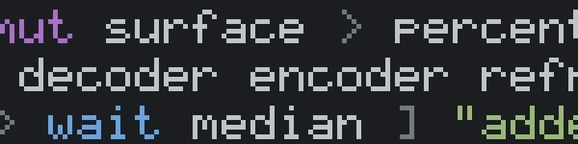
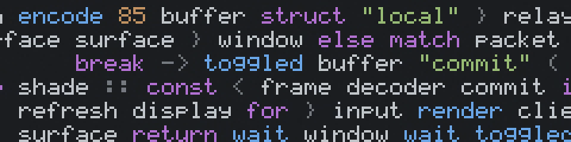
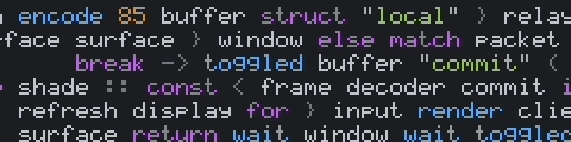

# 画質：キーフレーム、色の間引き、ビットレート（設定の比較 5）

- 日付：2026-11-16
- コミット：この記録と同じコミット（画質を測る道具、受信側の 4:4:4・sRGB・キーフレームの求め、送信側の設定）
- 目的：判定の前に、画質の条件を決めたい。遅延は画質と引き換えに小さくできるので、遅延の値には画質の値を並べて記録する。そのための道具を作り、次の 3 つを決める材料を出す。(1) キーフレームを必要なときだけにできるか。(2) 色つきの文字がにじまないか（4:2:0 と 4:4:4）。(3) 3440×1440 のビットレートをいくつにするか。
- 結論：下の「案」にまとめた。**追記：同じ日に、案のとおりに決まった**（[ADR 0002](../adr/0002-latency-first.md)）。設定は 4:4:4、キーフレームは求められたときだけ、上限 30 Mbps。画質の条件は 3 つとも採用。有線で中央値が届かなければ、先に圧縮を縮め、それでもだめなら 4:2:0 に戻す。

## 条件

| 項目 | 値 |
|---|---|
| ホスト | Ubuntu 24.04、RTX 4090（ドライバー 590.48.01）、GStreamer 1.24.2。エンコーダーは `nvcudah265enc`、復号は `nvh265dec` |
| クライアント | MacBook Air（M4）、macOS 26.5.1。VideoToolbox で復号。「Mac の画面に出る色」と「遅延」にだけ使った |
| 接続 | ホストは有線。Mac は Wi-Fi（5 GHz 帯のチャンネル 44、共有の機能は元の設定） |
| 絵 | テストアプリの動く絵（色つきの文字のスクロール）、3440×1440、毎秒 85 枚。線の太さは 2 ピクセル（判定の絵）と 1 ピクセル（いちばん厳しい場合） |
| クライアントのディスプレイ | 外部（3440×1440、84.96 Hz、拡大なし） |
| コーデック | H.265。4:2:0（Main）と 4:4:4（Main 4:4:4）、どちらも 8 ビット |
| エンコーダーの設定 | `preset=p1 tune=ultra-low-latency zero-reorder-delay=true b-frames=0 rate-control=cbr`。レート制御のバッファーは 1 フレームぶん（ビットレート ÷ 85）。ビットレート、キーフレームの間隔、色の間引きを振った（`scripts/m1_encoder.py`） |
| 経路 | ホストだけの計測では、どこにも送らない。Mac まで通すときは、RTP を UDP で。暗号化なし |

## 測り方

### ホストだけで測る値

[README.md](README.md) の「画質の計測」のとおりです。テストアプリの絵と同じものを作り（`istesso measure frames`）、手順 3 の送信側と同じエンコーダーに通して復号し、元の絵と比べます（`istesso measure quality`）。1,700 フレーム（20 秒）を通し、あとの 850 フレーム（10 秒）を集計しました。はじめは 510 フレーム（6 秒）だけ流して、あとの 425 フレームを集計していました。その値を使っているところは、表にそう書いてあります（下の「注意」）。

- **SSIM** は、元の絵とどれだけ同じ形をしているかを表す値で、1 が同じです。明るさと、色（2 つの色差の平均）について出します。表の 3 つの値は、全フレームの平均、悪いほうから 5% のフレーム、いちばん悪いフレームです。
- **PSNR** は、明るさの誤差を dB で表した値で、大きいほど良い値です。
- 絵は、テストアプリが窓に出すものと 1 画素も違いません（文字の表、流れる速さ、中央の四角が同じコードから出る）。中央の四角は、入力があったときと同じように、36 フレームごとに色を切り替えています。

### Mac の画面で見る値

色を間引いた絵を Mac がどう出すかは、ホストでは分かりません。そこで、文字を止めた絵（`--scroll 0`）を中継して、Mac の画面から窓を取り込み（`screencapture -l`）、元の絵と比べました。同じ絵を出した手元の窓も、同じように取り込みました。止めた絵なので、圧縮の損はほとんどなく、残るのは色の間引きと、色の変換と、Mac の色の扱いです。絵は 1600×720 で、拡大なしのディスプレイに等倍で出しています。

## 結果

### 1. 上限：圧縮をせずに、色の変換だけを往復させる

エンコーダーに渡す前に、絵を「明るさと色差」に変換します（8 ビット、16〜235 の範囲）。圧縮がどれだけ良くても、この往復の値は超えられません。

| 線の太さ | 色 | 明るさの SSIM（平均 / 5% / 最悪） | 色の SSIM（平均 / 5% / 最悪） | PSNR |
|---|---|---|---|---|
| 2 ピクセル | 4:2:0 | 0.9996 / 0.9996 / 0.9996 | 0.9786 / 0.9497 / 0.9459 | 47.5 dB |
| 2 ピクセル | 4:4:4 | 0.9996 / 0.9996 / 0.9996 | 0.9995 / 0.9995 / 0.9995 | 47.7 dB |
| 1 ピクセル | 4:2:0 | 0.9996 / 0.9996 / 0.9996 | 0.9033 / 0.8921 / 0.8912 | 46.7 dB |
| 1 ピクセル | 4:4:4 | 0.9996 / 0.9996 / 0.9996 | 0.9994 / 0.9994 / 0.9994 | 47.7 dB |

4:2:0 は、色の標本を 4 画素に 1 つしか持ちません。圧縮する前に、色の SSIM は 0.98（線が 1 ピクセルなら 0.90）まで下がります。フレームによって値が違うのは、文字が 1 フレームに 2 行か 3 行ずつ動くためです。奇数の行だけずれたフレームでは、文字の線が色の標本をまたぎます。

### 2. キーフレーム

3440×1440、線の太さ 2 ピクセル、30 Mbps を指定したときの値です。

| 色 | キーフレーム | 実際のビットレート | 明るさの SSIM（平均 / 5% / 最悪） | 色の SSIM（平均 / 5% / 最悪） | PSNR |
|---|---|---|---|---|---|
| 4:2:0 | 170 フレーム（2 秒）ごと。**これまでの設定** | 26.6 Mbps | 0.9951 / 0.9899 / **0.7615** | 0.9628 / 0.9370 / 0.8994 | 42.5 dB |
| 4:2:0 | はじめの 1 枚だけ | 26.6 Mbps | 0.9985 / 0.9983 / **0.9982** | 0.9654 / 0.9429 / 0.9407 | 44.2 dB |
| 4:4:4 | 170 フレームごと | 24.7 Mbps | 0.9962 / 0.9915 / **0.7669** | 0.9924 / 0.9491 / 0.8974 | 45.8 dB |
| 4:4:4 | はじめの 1 枚だけ | 4.8 Mbps | 0.9996 / 0.9996 / **0.9996** | 0.9991 / 0.9990 / 0.9990 | 47.7 dB |

- **キーフレームのたびに、絵が崩れます。** レート制御のバッファーを 1 フレームぶんにしてあるので、キーフレームも、ふつうのフレームに近い大きさ（72 kB まで）に収めなければなりません。前のフレームを使えないキーフレームには足りず、明るさの SSIM は 0.76〜0.81 まで落ちます。そこから 0.01 以内に戻るまでに、7 フレーム（82 ms）かかりました。これが 2 秒ごとに起きます（10 秒のあいだに 5 回とも）。
- バッファーを 2 フレームぶん（706 kbit）にしても、落ち込みは 0.75〜0.81 で、戻るまで 7〜10 フレームと、変わりませんでした。バッファーを外すと、キーフレームは 869 kB になり、Wi-Fi では届きません（[記録](2026-11-16-step3-moving-picture.md)）。
- **キーフレームをやめると、いちばん悪いフレームでも 0.998 以上です。** 4:4:4 では、上限（0.9996、47.7 dB）に届いています。
- **求められたときだけ出すことは、既製の部品でできます。** エンコーダーは、キーフレームなし（`gop-size=-1`）で動き、求められた次のフレームをキーフレームにします。下は、落ち着いたあと（1,300 フレーム目）で求めたときの値です。パケットが欠けたときに、これが 1 回起きます。

| 色 | 指定 | 求めて出したキーフレーム | 戻るまで |
|---|---|---|---|
| 4:2:0 | 30 Mbps | 明るさの SSIM 0.7816 | 13 フレーム（153 ms） |
| 4:4:4 | 30 Mbps | 0.7842 | 13 フレーム（153 ms） |

50 Mbps を指定すると、落ち込みは 0.82〜0.83、戻るまでは 10 フレーム（118 ms）でした（6 秒だけ流した計測での値）。

数字がどう見えるかを、絵の一部で示します（3440×1440 のうち 240×60 画素を、3 倍に拡大）。4:2:0、30 Mbps、キーフレームが 2 秒ごとの設定で、1,530 フレーム目がキーフレームです。

送った絵（1,530 フレーム目）：



キーフレームの 1 つ前（明るさの SSIM 0.9986。絵は 1 フレームぶん上にある）：



キーフレーム（0.8027）：



3 フレームあと（0.9639。1 フレームあとは 0.9078、7 フレームあとで 0.9929）：



同じフレームを、4:4:4、キーフレームなしで送ったとき（0.9996）：



### 3. ビットレート

3440×1440、線の太さ 2 ピクセル。「指定」はエンコーダーに渡した値、「実際」は出てきたストリームの値です。

キーフレームは、はじめの 1 枚だけ：

| 色 | 指定 | 実際 | 明るさの SSIM（平均 / 5% / 最悪） | 色の SSIM（平均 / 5% / 最悪） | PSNR | いちばん大きいフレーム |
|---|---|---|---|---|---|---|
| 4:2:0 | 10 Mbps | 13.5 Mbps | 0.9980 / 0.9975 / 0.9974 | 0.9563 / 0.9380 / 0.9345 | 43.4 dB | 31 kB |
| 4:2:0 | 30 Mbps | 26.6 Mbps | 0.9985 / 0.9983 / 0.9982 | 0.9654 / 0.9429 / 0.9407 | 44.2 dB | 51 kB |
| 4:2:0 | 50 Mbps | 40.0 Mbps | 0.9988 / 0.9986 / 0.9985 | 0.9688 / 0.9442 / 0.9418 | 44.9 dB | 74 kB |
| 4:2:0 | 80 Mbps | 61.8 Mbps | 0.9992 / 0.9991 / 0.9990 | 0.9718 / 0.9454 / 0.9434 | 45.8 dB | 115 kB |
| 4:4:4 | 10 Mbps | 5.4 Mbps | 0.9996 / 0.9996 / 0.9996 | 0.9990 / 0.9989 / 0.9989 | 47.7 dB | 20 kB |
| 4:4:4 | 30 Mbps | 4.8 Mbps | 0.9996 / 0.9996 / 0.9996 | 0.9991 / 0.9990 / 0.9990 | 47.7 dB | 15 kB |
| 4:4:4 | 50 Mbps | 4.8 Mbps | 0.9996 / 0.9996 / 0.9996 | 0.9991 / 0.9990 / 0.9990 | 47.7 dB | 15 kB |
| 4:4:4 | 80 Mbps | 4.8 Mbps | 0.9996 / 0.9996 / 0.9996 | 0.9991 / 0.9990 / 0.9990 | 47.7 dB | 15 kB |

キーフレームが 2 秒ごと（6 秒だけ流して、あとの 5 秒を集計した値。2 秒ごとに崩れては戻る形なので、長く流しても、ほぼ同じ値になる。30 Mbps の行を 20 秒流した値が、上の 2 の表）：

| 色 | 指定 | 実際 | 明るさの SSIM（平均 / 5% / 最悪） | 色の SSIM（平均 / 5%） | PSNR | キーフレームから戻るまで |
|---|---|---|---|---|---|---|
| 4:2:0 | 10 Mbps | 13.5 Mbps | 0.9938 / 0.9779 / 0.7644 | 0.9541 / 0.9291 | 40.7 dB | 14 フレーム（165 ms） |
| 4:2:0 | 20 Mbps | 20.6 Mbps | 0.9951 / 0.9875 / 0.7670 | 0.9609 / 0.9377 | 42.1 dB | 11 フレーム |
| 4:2:0 | 30 Mbps | 26.4 Mbps | 0.9958 / 0.9932 / 0.7808 | 0.9639 / 0.9417 | 42.8 dB | 7 フレーム（82 ms） |
| 4:2:0 | 50 Mbps | 39.6 Mbps | 0.9967 / 0.9963 / 0.7967 | 0.9676 / 0.9434 | 43.9 dB | 4〜6 フレーム |
| 4:2:0 | 80 Mbps | 60.7 Mbps | 0.9978 / 0.9977 / 0.8361 | 0.9710 / 0.9454 | 45.0 dB | 4 フレーム（47 ms） |
| 4:4:4 | 10 Mbps | 12.5 Mbps | 0.9954 / 0.9802 / 0.7660 | 0.9878 / 0.9181 | 44.6 dB | 14 フレーム |
| 4:4:4 | 20 Mbps | 19.2 Mbps | 0.9965 / 0.9907 / 0.7685 | 0.9920 / 0.9392 | 45.7 dB | 9〜11 フレーム |
| 4:4:4 | 30 Mbps | 24.2 Mbps | 0.9969 / 0.9935 / 0.7738 | 0.9938 / 0.9598 | 46.1 dB | 7 フレーム |
| 4:4:4 | 50 Mbps | 25.3 Mbps | 0.9976 / 0.9964 / 0.8027 | 0.9954 / 0.9780 | 46.5 dB | 6 フレーム |
| 4:4:4 | 80 Mbps | 24.7 Mbps | 0.9983 / 0.9976 / 0.8428 | 0.9964 / 0.9868 | 46.8 dB | 4 フレーム |

- **キーフレームなしの 4:4:4 は、何 Mbps を指定しても約 5 Mbps しか使わず、それで上限に届きます。** 流れる文字は、前のフレームをずらせば作れます。エンコーダーは、ほぼそのとおりに圧縮できています。
- **4:2:0 は、指定したぶんだけ使って、44〜46 dB にとどまります。** 4:2:0 のフレームの大きさを並べると、5、6 枚に 1 枚だけが小さく（12 kB 前後）、ほかは上限いっぱい（44 kB 前後）です。文字は 1 フレームに 2 行か 3 行動きます。2 行のときは色の標本とそろいますが、3 行のときは半分ずれて、前のフレームからの予測が合いません。その差にビットを使っています。
- **この絵では、ビットレートを上げても、もう良くなりません。** 4:2:0 に 10 Mbps を指定しても、エンコーダーは 13.5 Mbps を使います（下げきれない）。
- **キーフレームが 2 秒ごとだと、80 Mbps でも、いちばん悪いフレームは 0.84 です。**
- 1720×720 でも、同じ傾向でした（6 秒だけ流した計測）。2 秒ごとのキーフレームでは 0.76〜0.91 まで落ち、キーフレームなしの 4:4:4 は上限に届きます。

### 4. 線が 1 ピクセルの文字（いちばん厳しい場合）

3440×1440、キーフレームは、はじめの 1 枚だけ。

| 色 | 指定 | 実際 | 明るさの SSIM（平均 / 5% / 最悪） | 色の SSIM（平均 / 5% / 最悪） | PSNR |
|---|---|---|---|---|---|
| 4:2:0 | 30 Mbps | 27.1 Mbps | 0.9969 / 0.9967 / 0.9965 | 0.8753 / 0.8686 / 0.8657 | 40.0 dB |
| 4:2:0 | 50 Mbps | 40.1 Mbps | 0.9978 / 0.9977 / 0.9975 | 0.8794 / 0.8719 / 0.8694 | 41.4 dB |
| 4:4:4 | 30 Mbps | 31.2 Mbps | 0.9996 / 0.9996 / 0.9996 | 0.9979 / 0.9978 / 0.9978 | 47.3 dB |
| 4:4:4 | 50 Mbps | 22.6 Mbps | 0.9996 / 0.9996 / 0.9996 | 0.9979 / 0.9979 / 0.9978 | 47.6 dB |

細かい文字では、4:4:4 でも 23〜31 Mbps を使います。30 Mbps で、色の SSIM は最悪のフレームでも 0.9978 です。4:2:0 の色は、ビットレートに関係なく 0.87〜0.88 です（圧縮しない上限が 0.90）。

**プリセット。** 4:4:4、キーフレームなし、30 Mbps の指定で、p1（いちばん速い。ここまでの値はすべて p1）と p3 を比べました。p3 は 2.5 Mbps で、p1（4.8 Mbps）と同じ画質（明るさ 0.9996、色 0.9991、47.7 dB）になります。遅延への影響は、下の 6 にあります。

### 5. Mac の画面に出る色

止めた絵を中継して、Mac の画面から窓を取り込みました。数字は、取り込んだ画像の値（0〜255）です。画面の色の扱い（ディスプレイのプロファイル）を通ったあとの値なので、元の絵の値とは少し違います。**比べる相手は、同じ絵を出した手元の窓です。**

**色の伝え方。** はじめ、中継の絵は、手元の窓より少し明るく出ていました。

| 元の絵の色（sRGB） | 手元の窓 | 中継の窓（これまで） | 中継の窓（直したあと） |
|---|---|---|---|
| 紙 30, 32, 38 | 28, 29, 34 | 29, 32, 35 | 27, 29, 32 |
| ふつうの文字 200, 204, 212 | 194, 197, 205 | 199, 203, 207 | 191, 196, 201 |
| 中央の四角（暗いほう）32, 32, 32 | 29, 29, 29 | 31, 31, 31 | 29, 29, 29 |

- 手元の窓の値は、sRGB の色をふつうの窓に塗ったときの値と同じでした（別の窓で確かめた）。
- これまでのストリームは、自分の色を「ビデオ（BT.709）」と名乗っていました。Mac は、ビデオの絵を、窓の絵とは違う明るさの曲線で出します。
- ストリームに「絵は sRGB」と書くようにしました（`scripts/m1_encoder.py`）。ただし、**VideoToolbox は、そう書いてあっても、復号した絵を BT.709 のビデオとして渡します。** 受信側（`gst-viewer`）で、復号した絵の置き場所（IOSurface）に sRGB のプロファイルを付けると、手元の窓と同じ明るさになりました。絵そのものに付ける方法（CVBuffer の属性）では、変わりませんでした。
- 直したあとも、青が 2〜4 レベル低く出ます。8 ビットの「明るさと色差」（16〜235）に変換するときに、GStreamer の変換が端数を切り捨てるためです（紙の色の青は 38 が 35 になる）。自前の実装で、四捨五入にするか、範囲を 0〜255 にすれば、小さくできます。

**色の間引き。** 手元の窓との差を、元の絵の色ごとに、画素ごとに取って平均した値です（1 チャンネルあたりのレベル）。中継は、色の伝え方を直したあとの形です。

| 元の絵の色 | 4:4:4、線 2 ピクセル | 4:2:0、線 2 ピクセル | 4:4:4、線 1 ピクセル | 4:2:0、線 1 ピクセル |
|---|---|---|---|---|
| 紙 | 1.0 | 1.2 | 1.0 | 1.5 |
| ふつうの文字（白に近い灰色） | 2.7 | 2.6 | 2.6 | 2.6 |
| 記号（灰色） | 1.7 | 1.7 | 1.8 | 2.1 |
| キーワード（紫） | 1.5 | **14.7** | 1.5 | **27.8** |
| 関数（青） | 1.4 | **12.7** | 1.4 | **24.8** |
| 文字列（緑） | 0.9 | **7.8** | 1.0 | **18.1** |
| 数（橙） | 0.9 | **10.2** | 1.1 | **21.1** |

| | 手元の窓 | 4:4:4 | 4:2:0 |
|---|---|---|---|
| 画面の絵と元の絵の、色の SSIM（青の色差 / 赤の色差）。線 2 ピクセル | 0.9998 / 0.9979 | 0.9989 / 0.9969 | 0.9835 / 0.9804 |
| 同じく、線 1 ピクセル | 0.9998 / 0.9968 | 0.9982 / 0.9956 | 0.9117 / 0.9212 |

- **4:2:0 では、色つきの文字が薄くなります。** 紫のキーワード（198, 120, 221）は、手元の窓では 178, 112, 210、4:2:0 の中継では 162, 117, 187 です。線が 1 ピクセルだと 149, 123, 167 で、ほとんど灰色です。灰色の文字と紙は、変わりません。
- **4:4:4 では、どの色も手元の窓と 3 レベル以内です。**
- **M4 の VideoToolbox は、H.265 の 4:4:4 をハードウェアで復号します。** 復号した絵を 4:4:4 のまま受け取り（`444v`）、そのまま窓に渡せました。

画面から取り込んだ絵の一部です（3 倍に拡大。上から、手元の窓、4:4:4、4:2:0）。

線 2 ピクセル：






線 1 ピクセル：






### 6. 遅延（Mac まで通した値）

[README.md](README.md) の「内訳の計測」のとおり、500 回ずつです。3440×1440 の動く絵、毎秒 85 枚を超えないコンポジター、ホストのテストアプリは GPU で描画、30 Mbps を指定、Mac は 1720×720 の窓に縮めて表示、2 つの窓は前面に出さずに起動。17:24 から 17:48 に測りました。キーフレームなしの回は、はじめのキーフレームを、計測のスクリプトがホストに求めています（下の「注意」）。

| 設定 | 追加遅延の、手元の窓との差（中央値 / 95% / 99%） | 中継した窓（中央値 / 95%） | 手元の窓（中央値） | 実際のビットレート | 入力を映したフレーム |
|---|---|---|---|---|---|
| 4:2:0、キーフレーム 2 秒ごと（これまでの設定） | 13.2 / 17.7 / 21.2 ms | 31.0 / 40.8 ms | 17.7 ms | 26.2 Mbps | 39.9 kB、35 パケット |
| 4:2:0、キーフレームなし | 14.0 / 17.3 / 21.9 ms | 31.6 / 40.0 ms | 17.5 ms | 26.4 Mbps | 39.1 kB、34 パケット |
| 4:4:4、キーフレーム 2 秒ごと | 15.8 / 19.1 / 23.6 ms | 33.7 / 42.1 ms | 17.9 ms | 24.6 Mbps | 36.6 kB、32 パケット |
| **4:4:4、キーフレームなし** | **15.5 / 16.9 / 16.5 ms** | 32.7 / 39.9 ms | 17.3 ms | 5.5 Mbps | 8.0 kB、8 パケット |
| 4:4:4、キーフレームなし、プリセット p3 | 16.6 / 20.1 / 27.2 ms | 34.5 / 43.1 ms | 17.9 ms | 2.6 Mbps | 4.1 kB、5 パケット |

500 回なので、99 パーセンタイルは判断に使いません。手元の窓の中央値は、どの回も、いつもの値（17.3 ms）から 0.6 ms 以内でした。

内訳（平均）：

| 区間 | 4:2:0、2 秒ごと | 4:2:0、なし | 4:4:4、2 秒ごと | 4:4:4、なし | 4:4:4、なし、p3 |
|---|---|---|---|---|---|
| ネットワーク（行きと帰り） | 5.7 ms | 5.6 ms | 5.8 ms | 5.8 ms | 6.6 ms |
| コンポジター | 1.9 ms | 2.1 ms | 2.1 ms | 1.7 ms | 2.0 ms |
| **色の変換と圧縮** | 2.6 ms | 2.6 ms | **4.1 ms** | **4.1 ms** | **5.6 ms** |
| パケットにして渡す | 0.2 ms | 0.2 ms | 0.2 ms | 0.2 ms | 0.2 ms |
| **フレームが届く（最初のパケットから最後まで）** | 1.2 ms | 1.2 ms | 1.0 ms | **0.3 ms** | 0.2 ms |
| **復号** | 2.4 ms | 2.3 ms | **3.3 ms** | **3.1 ms** | 3.2 ms |
| 描くまで | 0.4 ms | 0.4 ms | 0.4 ms | 0.4 ms | 0.4 ms |
| 描いてから、画面に出るまで | 17.3 ms | 17.7 ms | 17.2 ms | 17.4 ms | 17.5 ms |

- **4:4:4 にすると、圧縮が 1.5 ms、復号が 0.8 ms 延びます。** 中央値の差は、1.5〜2.6 ms 大きくなりました。
- **4:4:4 でキーフレームをやめると、フレームが 5 分の 1 になります**（37 kB から 8 kB）。届くまでの時間が 0.6 ms 縮み、95 パーセンタイルは 19.1 ms から 16.9 ms になりました。4:2:0 では、キーフレームをやめてもフレームは小さくなりません（上の 3）。
- **プリセットを p3 にすると、フレームはさらに半分になりますが、圧縮が 1.6 ms 延びます。** 得になりません。p1 のままにします。

**パケットが欠けたとき。** キーフレームなしの 4:4:4 で、ホストが 4 秒ごとに 1 フレームぶんのパケットをわざと捨て、受信側が求めて戻るまでを見ました（45 秒、11 回）。受信側は、エージェントのシェルから起動しています（下の「注意」）。

| | 中央値 | いちばん短い | いちばん長い |
|---|---|---|---|
| 欠けに気づいてから、次の絵（キーフレーム）が出るまで | 17.8 ms | 16.1 ms | 26.7 ms |
| 窓が、最後の正しい絵のまま止まっていた時間 | 26.8 ms | 24.5 ms | 39.3 ms |
| ホストで、求めが届いてから、キーフレームがエンコーダーを出るまで | 6.7 ms | 5.6 ms | 15.0 ms |

11 回とも、求め 1 回でキーフレームが 1 枚（66〜72 kB）出て、戻りました。欠けると、絵がフレーム 2 枚ぶんほど止まり、そのあと 150 ms ほど粗くなる（上の 2）、ということになります。

カメラでの計測：行っていません。

## わかったこと

1. **いまの設定のいちばんの弱点は、2 秒ごとのキーフレームでした。** そのたびに絵が崩れ（明るさの SSIM で 0.76〜0.81）、80 ms かけて戻ります。ビットレートを 80 Mbps に上げても、0.84 までしか良くなりません。
2. **キーフレームをやめるだけで、いちばん悪いフレームが 0.998 以上になります。** エンコーダーにも受信側にも、新しい部品は要りませんでした。受信側が、始めと、パケットが欠けたときに、送信側へ求めます（RTCP の picture loss indication）。
3. **色つきの文字は、4:2:0 ではにじみます。** Mac の画面で、手元の窓との差が 1 チャンネルあたり 8〜15 レベル、細い文字では 18〜28 レベルです。4:4:4 では 3 レベル以内です。
4. **4:4:4 の代わりに払うのは、ビットではなく時間です。** この絵では、4:4:4 のほうが少ないビットで済みます（キーフレームなしの配信で、5.5 Mbps と 26.4 Mbps）。圧縮と復号が、合わせて 2.3 ms 延びます。
5. **色の伝え方にも、直すところがありました。** 中継の絵が、手元の窓より少し明るく出ていました。
6. **この絵は、キーフレームさえなければ、エンコーダーにとって易しい絵です。** 流れる文字は、前のフレームをずらせば作れます。ビットレートの上限を決める材料には、なりません。

## 案

決めるのは人です。

**設定の案**（3440×1440、判定に使う形）：

| 項目 | 案 | 理由 |
|---|---|---|
| キーフレーム | 求められたときだけ | 上の 1 と 2。遅延は変わらないか、少し良くなる |
| 色 | 4:4:4 | 上の 3。色で、中継の窓だと分かってしまう。代わりに、差の中央値が 1.5〜2.6 ms 増える |
| ビットレート | 30 Mbps のまま（上限として） | この絵では、約 5 Mbps しか使わない。細い文字でも 30 Mbps で足りる（上の 4）。欠けたあとの戻りは、50 Mbps にすると 153 ms が 118 ms になるが、そのぶんキーフレームが大きくなる |
| プリセット | p1 のまま | p3 は、圧縮が 1.6 ms 延びる |
| 色の伝え方 | 絵は sRGB と書き、受信側はそのとおりに出す | 上の 5 |

**画質の条件の案**（判定の計測と同じ設定のエンコーダーに、判定と同じ絵を通して、`scripts/m1-quality.py` で測る）：

| 条件 | 案 | 何を防ぐか | これまでの設定 | 案の設定 |
|---|---|---|---|---|
| 明るさの SSIM が、いちばん悪いフレームでも | 0.99 以上 | 決まった間隔で絵が崩れること | 0.76 | 0.9996 |
| 色の SSIM が、悪いほうから 5% のフレームでも | 0.99 以上 | 色つきの文字がにじむこと。4:2:0 は、圧縮しなくても 0.95 | 0.94 | 0.9990 |
| 止めた絵を Mac の画面に出したとき、手元の窓との差が、どの色でも | 1 チャンネルあたり平均 5 レベル以内 | 色で見分けがつくこと | 14.7（紫の文字） | 2.7（白に近い文字） |

- パケットが欠けて、キーフレームを出し直したあとの落ち込みは、条件に入れません。回数と、戻るまでの時間を記録します。
- 判定の計測では、キーフレームは、はじめの 1 枚と、求められたものだけとし、その数を記録します。

**4:4:4 の時間について。** いまの値（Wi-Fi で、差の中央値 15.5 ms）から、Mac を有線にしたときの見込みを、[前の記録](2026-11-16-step3-85fps-gpu-app.md)と同じやり方で出すと、次のとおりです。

| 区間（平均） | 4:2:0、キーフレームなし | 4:4:4、キーフレームなし | 有線にしたら |
|---|---|---|---|
| ネットワーク | 5.6 ms | 5.8 ms | 1.5 ms（見込み） |
| コンポジター | 2.1 ms | 1.7 ms | そのまま |
| 色の変換と圧縮 | 2.6 ms | 4.1 ms | そのまま |
| パケットにして渡す、届く | 1.3 ms | 0.5 ms | 0.5 ms（見込み） |
| 復号、描くまで | 2.6 ms | 3.4 ms | そのまま |
| 手元の窓との差（平均） | 14.2 ms | 15.3 ms | **4:2:0 は約 9.3 ms、4:4:4 は約 11.0 ms** |

4:4:4 でも 12 ms には収まる見込みですが、余裕は約 1 ms です。ネットワークの 1.5 ms は見込みで、測った値ではありません。足りなかったときの手は、圧縮を縮めること（GPU の 2 つのエンコーダーに 1 フレームを分ける機能。GStreamer 1.24 からは指定できないので、NVENC を直接使うことになる。[ADR 0009](../adr/0009-host-compositor.md)）か、4:2:0 に戻すことです。

## 注意

- **画質の値は、遅延を測ったストリームそのものの値ではありません。** 同じエンコーダーに、同じ設定で、同じ絵を通した値です。実際の配信と同じビットレートに落ち着くことは確かめました（キーフレームなしのとき、4:4:4 は配信で 5.5 Mbps、この計測で 4.8 Mbps。4:2:0 は 26.4 Mbps と 26.6 Mbps。p3 は 2.6 Mbps と 2.5 Mbps）。はじめは 6 秒だけ流して測っていて、そのときは 16.3 Mbps と出ました。キーフレームのあと、エンコーダーが絵を直し終えるまでに 6〜7 秒かかるためです。キーフレームなしの値は、どれも 20 秒流して、あとの 10 秒を集計した値です。
- **Mac の画面での比較は、止めた絵です。** 動く絵は、画面から取り込んだフレームが、元のどのフレームにあたるかを決められないので、比べていません。止めた絵では圧縮の損がほぼなくなるので、見えているのは、色の間引きと、色の変換と、Mac の色の扱いです。
- **受信側は、`open` で起動すると、キーフレームを求められません。** macOS の「ローカルネットワーク」の許可がないと、アプリは LAN へパケットを送れないためです（`No route to host`）。遅延の計測では、はじめのキーフレームを、計測のスクリプトが SSH でホストに求めました（`USR1`）。そのあいだにパケットが欠けていれば、絵は止まったままになりますが、どの回も欠けは 0 でした。欠けたときの計測は、受信側をエージェントのシェルから起動して行いました。優先度が低いので、時間は少し長めに出ているはずです。**判定の前に、人が、アプリにローカルネットワークを許可する必要があります。** 自前のクライアントも、入力を送るために、同じ許可が要ります。（追記：許可は、この計測の途中の 17:13 に出ていました。一覧には `gst-viewer` の名前で載っています。18:42 に `open` で起動した受信側は、自分で求めて絵を出しました。[README.md](README.md) の「Mac で計測するプログラムの起動のしかた」。）
- **キーフレームの求めは、暗号化も認証もしていません。** 同じネットワークの誰でも送れます。起きるのは、キーフレームが 1 枚出ることだけですが、計測のためだけの仕組みです。
- **GStreamer のソフトウェアの色変換（`videoconvert`）は、最大で 5 レベルずれます。** はじめ、圧縮しない往復でも PSNR が 36 dB にしかならず、調べて分かりました。画質の計測では、戻す変換も GPU（`cudaconvert`）で行っています。こちらは 47.7 dB です。
- ビットレートの「指定」と「実際」は、合いません。エンコーダーは、易しい絵では指定より少なく使い、4:2:0 に 10 Mbps を指定すると多く（13.5 Mbps）使います。
- この絵は、作りものです。写真や動画のような絵では、値が変わります。M1 の判定には使いませんが、ビットレートの上限を決めるときには、そういう絵を足して測る必要があります。

## 再現のしかた

```sh
# ホストで。上限、ビットレートと色とキーフレームの一覧、細い文字、求めて出すキーフレーム
scripts/m1-quality.py --size 3440x1440 --no-codec --chroma 420,444
scripts/m1-quality.py --size 3440x1440 --chroma 420,444 --gop -1 --bitrate 10000,30000,50000,80000
scripts/m1-quality.py --size 3440x1440 --chroma 420,444 --gop 170 --bitrate 30000
scripts/m1-quality.py --size 3440x1440 --scale 1 --chroma 420,444 --gop -1 --bitrate 30000,50000
scripts/m1-quality.py --size 3440x1440 --chroma 420,444 --gop -1 --bitrate 30000 --key-at 1300
```

遅延は、送信側に `--chroma 444 --gop -1 --key-requests` を足して、[README.md](README.md) の「内訳の計測」のとおりに測ります。欠けたときの動きは、送信側に `--lose 4` を足すと見られます。

