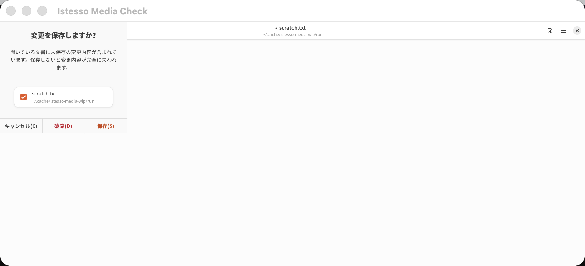
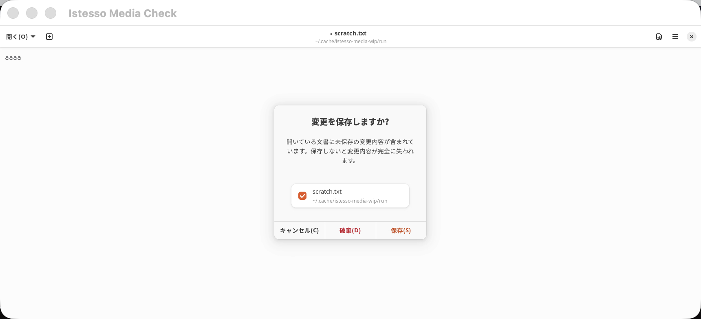

# アプリがあとから開く窓（尋ねる窓、ファイルを選ぶ窓）を、絵に出す：原因と、直したあとの確認

- 日付：2026-11-17（03:44〜03:56）
- コミット：467d163（コンポジターの 4 つ目の修正）。この記録は、次のコミット
- 目的：[前の記録](2026-11-17-session-controls.md)で見つかった不足を直す。保存していない文字があるテキストエディターに閉じるよう頼むと、エディターは「保存しますか」と尋ねる窓を作るが、その窓が絵に出ない。人は、尋ねられていることが分からず、答えられない。アプリが自分のトップレベルとして開く窓（ファイルを選ぶ窓、設定の窓）は、どれも同じになる
- 結論：**原因は、コンポジターが窓の大きさを知るのが、1 回遅いこと。直した。** 尋ねる窓は、何も押さなくても、元の窓の中央に出る。キー（Escape）でも、クリック（「破棄」）でも答えられ、答えたあとは、キーボードとポインターが元の窓に戻る。窓の数と `empty` は、前と同じに働く。エディターのファイルを選ぶ窓も、エディター自身の窓で、同じように出る
- 直す前は、**尋ねる窓が、見えないままキーボードを持っていた。** 閉じるよう頼んだあとに人が打ったキーは、見えない窓に届いていた

## これは、遅延の計測ではない

人が見て分かること（窓が出るか、答えられるか）の確認です。Mac の側のプログラムは、シェルから起動しました（アプリのバンドルも、`open` も使っていません）。窓は、内蔵ディスプレイの隅に小さく出し、前面に固定せず、取り込んだら閉じました。Mac のポインターは、動かしていません。

入力の経路には、手を入れています（下の「直したこと」の 4）。ポインターが動くたびに、「いま下にある窓」を 1 回多く探します。この時間は、測っていません。

## 条件

| 項目 | 値 |
|---|---|
| ホスト | Ubuntu 24.04、RTX 4090、GStreamer 1.24.2。コンポジターは、4 つの修正を当てたもの。自分の作業用の写しでビルドした |
| クライアント | MacBook Air（M4）、macOS 26。ビューアーは、シェルから起動 |
| 絵 | 1720×720、毎秒 85 枚まで。1 回だけ、640×360 |
| 経路 | 暗号化した経路（ADR 0015）。2 台の、実際のペアリングと鍵 |
| アプリ | テキストエディター（gnome-text-editor。`/usr/bin` のもの。サンドボックスには入っていない）。状態の置き場所（`XDG_DATA_HOME`、`XDG_CONFIG_HOME`、`XDG_STATE_HOME`、`XDG_CACHE_HOME`）は、回ごとに新しい、自分のフォルダー。開くファイルは、自分の空のファイル |
| 入力 | このパイプラインだけのソケットに、キーとポインターを書いた（`--input-socket`）。人が試している経路のソケットにも、入力の中継にも、触れていない |
| 持ち主のエディターの状態 | 置き場所（`~/.local/share/org.gnome.TextEditor/`）の、名前・大きさ・時刻を、回の前後で比べた。**4 回とも、変わっていない** |

## 原因

コンポジター（gst-wayland-display）は、新しいトップレベルを、**最初の絵が届いた確定（commit）の処理の中で**、絵に入れます。ところが、窓に「自分の大きさを調べ直せ」と言う（`Window::on_commit`）のは、その処理の始めに、**すでに絵に入っている窓だけ**でした。そのため、窓は、大きさが 0×0 のまま絵に入り、**次の確定**で、初めて大きさが分かります。

描き続けるアプリの窓は、すぐに次の確定をするので、気づきません。1 回描いて、人の答えを待つ窓は、次の確定をしません。大きさが 0×0 の窓は、描かれず、ポインターにも見つかりません。

### 直す前に、コンポジターが 2 枚目のトップレベルをどう扱っていたか

コンポジターのテストの仕組み（本物の Wayland クライアント。出力は 320×240）で、1 枚目の窓のあとに、120×80 の白い窓を、1 回だけ描いて開きました。親を指定したもの（`xdg_toplevel.set_parent`）と、しないものの両方です。

| 見たこと | 直す前 |
|---|---|
| 置く場所 | 出力の左上（0,0）。親があっても、同じ |
| 重なり | いちばん上 |
| 言われる大きさ | 出力と同じ大きさで、全画面。親があっても、同じ（最大の大きさを持つ窓だけ、言われない） |
| フレームに出るか | **出ない。** 白い画素は、9,709 個のはずが 109 個（もとからあるもの）。窓がもう 1 度確定すると、出る |
| キーボード | 開いたときに、その窓へ移る。**見えていなくても** |
| ポインター | 大きさが 0×0 なので、届かない |
| 閉じたとき | キーボードを、どの窓にも戻さない |

### 本物のエディターで

保存していない文字がある状態で、閉じるよう頼みました。窓の数は 2 になり、Mac の窓には、元の窓しか映りません。ここで、キーを **1 回**（Tab）送ると、尋ねる窓が、左上の隅に、自分の大きさ（約 373×330 ピクセル）で現れました。キーを受けて、描き直した（もう 1 度確定した）からです。



## 直したこと

4 つ目の修正のファイル（`scripts/patches/gst-wayland-display-dialogs.patch`。前の 3 つの上に重ねる。前の 3 つは、変えていない）。

1. **大きさを、最初の絵が届いた確定で調べる。** 1 回しか描かない窓も、絵に出て、ポインターが届く。
2. **親のあるトップレベル（アプリが「この窓の子」と言った窓）は、全画面にしない。** 使える広さ（出力の大きさ）だけを伝え、窓が望む大きさのまま、**親の中央**に置く。出力からはみ出すときは、収まるところまで寄せる。出力より大きい窓は、左上の隅から置き、収まらないぶんは見えない（落ちない）。
3. **窓が閉じたら、すぐに絵から外し、キーボードを、そのとき いちばん上の窓へ渡す。** 尋ねる窓に答えると、元の窓がキーボードを取り戻す。
4. **ポインターのイベントを、ポインターが「いまある」ところの窓へ送る。** これまでは、ポインターが「さっきまであった」ところの窓へ、動きを送っていた。窓が 1 枚で出力を覆っているあいだは、どちらも同じ窓なので、違いが出ない。窓が 2 枚あると、1 回で跳んでからのクリックが、離れたほうの窓に届く。窓が、ほかの窓の上に開いたとき、閉じたときには、ポインターが動いていなくても、下にある窓を調べ直す。
5. **窓をクリックしても、その窓を親とする窓は、前に残す。**

設定（プロパティ）は、付けていません。**いつも入ります。** 直しているのは不具合で、窓が 1 枚のアプリでは、何も変わらないためです（1 枚目の窓は、置く場所も、言われる大きさも、ポインターの扱いも、前と同じ）。

### 親のないトップレベルが、1 回だけ描くとき

アプリによっては、尋ねる窓を、親を言わずに開きます。この窓は、前と同じに扱います：出力と同じ大きさで全画面と言われ、左上の隅に、いちばん上に置かれます。**直したあとは、1 回しか描かなくても、絵に出て、クリックが届きます**（テストで確かめた）。

- 言われたとおりの大きさにする窓は、出力をすべて覆います。元の窓は、その下に隠れ、あとの窓が閉じると、また見えて、キーボードとポインターが戻ります。
- 言われても自分の大きさのままの窓は、左上の隅に、自分の大きさで出ます。中央には、寄せません（親が分からないので、どの窓の上に置くかが決まらない）。

### アプリが、ふつうの窓を 2 枚開いたとき

2 枚とも、出力と同じ大きさで、1 枚の絵の、同じ場所に重なります。あとの窓が上で、先の窓は見えません。あとの窓を閉じると、先の窓が出ます。これは、直す前と同じです（違いは、2 枚目が、最初の絵から見えること）。外から窓を切り替える手段は、まだありません。

「1 つのアプリの複数の窓を、クライアントの別々の窓にする」（まだ作らない）への道は、ふさいでいません。置く場所の決まりは、関数 1 つ（`comp/windows.rs` の `place`）で、絵の作り方には触れていません。3 つ目の修正が出す、窓の数の知らせ（`wayland.windows`）に、窓ごとの場所・大きさ・親を載せれば、クライアントが窓を分けて出す材料になります。

## 直したあとの確認

### コンポジターのテスト

`cargo test -p wayland-display-core`：ホストで **62 本**が通ります（うち 8 本が今回のもの。6 本は、本物の Wayland クライアントが、1 回だけ描く 2 枚目の窓を開く）。

| テスト | 確かめること |
|---|---|
| 1 回だけ描く窓（親なし） | フレームの左上に、窓の 120×80 がすべて出る。キーボードを持つ。ポインターを 1 回で跳ばしてクリックすると、その窓に届く。**今回の不具合そのもの** |
| 親のある窓 | 全画面と言われず、使える広さ（320×240）だけを言われる。親の中央（100,80）に出る。そこに止まっていたポインターは、動かなくても、その窓のものになり、クリックが届く。外へ跳ぶと親へ、戻ると子へ |
| 来て、去る | 開くとキーボードが移り、閉じると、親に戻る。ポインターも戻り、窓は絵から消える。最後の窓も閉じると、キーボードは、どこにもない（落ちない） |
| 親をクリック | 子は、前に残る |
| 出力より大きい子（400×300） | 左上の隅から置かれ、フレームは作られる |
| ふつうの窓が 2 枚 | 2 枚とも全画面と言われ、あとの窓が上 |
| 置く場所の決まり（2 本） | 中央、端に寄った親、出力より大きい窓、出力とちょうど同じ窓、親なし |

4 つの修正を、元のコミット（`1301f86`）に順に当てると、ビルドしてテストした木と、1 バイトも違いません。

### 本物のエディターで（2 台で）

Mac のビューアーの窓を取り込んで、絵の中の同じ範囲を、画素ごとに比べました（範囲は、ホストの絵の座標）。

| したこと | 窓の数 | 絵 |
|---|---|---|
| 4 文字打つ | 1 | （基準） |
| `close` と言う。**何も押さない** | 2 | 尋ねる窓が、中央（673,195 から 1047,525）に出た。この範囲の 123,420 画素のうち、9,334 画素が基準と違う。その左（342,000 画素）は、1 画素も違わない |
| Escape を送る（「キャンセル」） | 1 | 基準と、1 画素も違わない。`empty` は出ない。エディターは残り、ファイルは 0 バイトのまま |
| Ctrl+O を送る | 2 | ファイルを選ぶ窓が、中央に出た（約 813×372）。**エディター自身のトップレベル**で、このコンポジターの中にある |
| Escape を送る | 1 | 元に戻る |



2 回目（新しい状態の置き場所で、同じく 4 文字打って `close`）：

| したこと | 窓の数 | そのあと |
|---|---|---|
| ポインターを「破棄」のボタン（859,502）へ **1 回で**跳ばして、クリック | 2 → 1 → 0 | `{"istesso":"empty"}` が出た。エディターは、自分で終わった。ファイルは 0 バイトのまま（何も書かれていない） |

3 回目（絵を 640×360 にして）：

| したこと | 窓の数 | 絵 |
|---|---|---|
| Ctrl+O を送る | 2 | ファイルを選ぶ窓は、言われた広さに自分で合わせて、絵いっぱいに出た。両方のボタンが見える |
| Escape を送り、`close` と言う（保存するものは、ない） | 1 → 0 | `empty` が出た。前と同じ |

ファイルを選ぶ窓を取り込んだ画像には、ホストのホームのフォルダーの名前が映るので、ここには置いていません。

## 見つかったこと

- **サンドボックスに入ったアプリ（Flatpak、Snap）のファイルを選ぶ窓は、別の話になる。** こういうアプリは、ファイルを選ぶ窓を、自分では開かず、デスクトップの「ポータル」という別のプロセスに頼みます。そのプロセスは、このコンポジターの外にいるので、窓は、ホストの本物のデスクトップに出るか、どこにも出ません。今回のエディターは、サンドボックスの外のものなので、これには当たりませんでした。**確かめていません。** アプリを選ぶときに、持ち主が知っておくことです。
- 上流のコードには、ポインターの動きを「さっきまであった」ところの窓へ送る、という不具合がありました（直したことの 4）。窓が 1 枚のあいだは、表に出ません。

## まだ確かめていないこと

- 人が、Mac の本物のキーボードとマウスで答えること（下の「朝に見ること」）。
- 尋ねる窓が出ているときに、親の窓をクリックすること（子は前に残るが、キーボードは親に移る。テストでは、重なりだけを見た）。
- 窓が、開いたあとに大きさを変えたとき（置き直さない）。親を、あとから言ったとき（動かさない）。
- 親のないトップレベルを、1 回だけ描いて開く、本物のアプリ（テストの仕組みでだけ、確かめた）。
- メニューが開いているあいだ（ポインターをつかんでいるあいだ）に、窓が開いたとき。
- 決まった拍で描く設定（`--no-render-on-commit`）。
- 人が試している窓（`scripts/try.sh`）は、1 つ目の修正だけのコンポジターを使っているので、**まだ直っていません**。4 つの修正を当てたものに替えるのは、持ち主が決めることです（`TRY=channel` の形では、4 つとも入ります。下の「朝に見ること」）。

カメラでの計測：行っていません。

## 朝に見ること（数分、コマンド 1 つ）

Mac のキーボードとマウスを使うので、人が行います。今夜作ったもの（暗号化した経路、クライアントで描くカーソル、閉じるよう頼むこと、あとから開く窓）を、まとめて見られます。

1. Mac のターミナルで、このブランチの作業ツリー（今夜のものは、リポジトリーの隣の `link-proj-media`。ビューアーと `istesso` は、ビルドしてある）に入って、次を実行する。アプリは、ふだん試しているものでよい。

   ```sh
   TRY=channel scripts/try.sh gnome-text-editor --standalone
   ```

   - **いま試している窓は、止まります**（同じ名前の `tmux` のセッションと、同じ入力の経路を使うため。`scripts/try.sh` を起動し直すときと同じ）。そちらのアプリに保存していないものがあれば、先に保存してください。
   - ホストの側は、今夜のビルドを使います（`~/.cache/istesso-media-wip/` の、リポジトリーの写しと、4 つの修正を当てたコンポジター）。場所を変えるときの設定は、`scripts/try.sh` の先頭にあります。
   - ビューアーと入力の中継は、アプリとしてではなく、そのターミナルから、ふつうのプログラムとして起動されます。**見るには足ります。計測には使えません**（優先度が、アプリとして起動したときより低い）。アプリのバンドルは、作りも、触りもしません。

2. 見ること。

   | すること | こうなるはず |
   |---|---|
   | 窓をクリックして、ポインターを窓の中で動かす | Mac の矢印が消えて、アプリのカーソルが、手のとおりに動く。絵の中に、もう 1 つのカーソルが見えない |
   | 文字のところと、ボタンのところを行き来する | I 字と矢印が、切り替わる |
   | 何か打ってから、エディターの「閉じる」ボタン（×）を押す | 「保存しますか」と尋ねる窓が、中央に出る。マウスで「キャンセル」を押せる。もう 1 度出して、キーボード（Escape）でも消せる |
   | Command-A、Command-S | Control として届く（すべて選ばれる。新しい文書なら、保存の窓が、中央に出る） |
   | 2 本指でスクロールする | 長い文書が、手のとおりに動く |

3. 終わったら、止める。

   ```sh
   scripts/try.sh stop
   ```

   これまでの形（暗号化しない経路）に戻すときは、これまでどおり `scripts/try.sh <アプリ>` です。

気づいたことがあれば、どの行で、どう違ったかを知らせてください。

### このコマンドについて、確かめたことと、確かめていないこと

持ち主が試している窓を止めずに確かめるため、**自分の名前とポート**で動かしました（`ISTESSO_TRY_NAME=media-try`、ポート 47832、860×360 の小さい窓を内蔵ディスプレイの隅に。アプリは、状態の置き場所を分けたテキストエディター）。

| 確かめたこと | 結果 |
|---|---|
| 絵 | 自分の窓に出た（暗号化した経路） |
| カーソル | ホストのポインターを文字の欄の上に動かすと、ビューアーが I 字を描いた。尋ねる窓が出ると、矢印に変わった |
| キー | 自分のソケットから 4 文字送ると、エディターに 4 文字出た |
| 尋ねる窓 | 閉じるよう頼むと、窓の数が 2 になり、絵の中央に出た（309,600 画素のうち 15,825 画素が変わった）。Escape で消えて、絵は、元と 1 画素も違わない |
| 止める | 同じ名前で `stop` すると、自分のビューアー、`tmux` のセッション 2 つ、パイプライン、エディターが、すべて止まった |
| 持ち主と、ほかの流れのもの | Mac の、持ち主のビューアーと入力の中継、音の試験のプログラム。ホストの `step3`、`istesso-app`、`istesso-agent`、`m2-audio-run`、持ち主のパイプラインとエージェント、エディターの状態の置き場所。**プロセスの番号も、始まった時刻も、前後で同じ** |

**確かめていないこと**（持ち主の名前を使わないと、確かめられない）：

- 名前を付けない、ふつうの形での起動。つまり、**シェルから起動した入力の中継 → ホストのふつうのエージェント → 既定のソケット → このパイプライン**、という入力の道。名前を付けた回では、窓からの入力は渡しません（エージェントは、既定のソケットにしか渡さないため）。中継のプログラムと引数は、これまでの形と同じものです。
- 既定のポート（47803）。確かめたのは、47832 です。
- 名前を付けない `stop`（記録しておいたプロセスを止めたあと、これまでどおり、名前で止める）。
- 本物のポインターとキーボード（上の表）。
