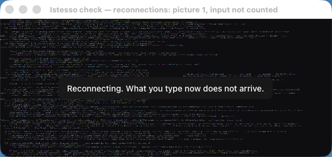
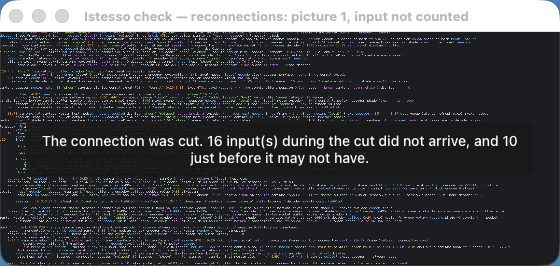
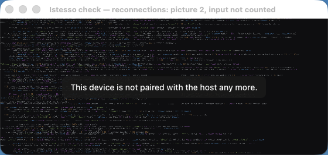

# 切れたあとのつなぎ直し（映像と入力）：2 台での確認

- 日付：2026-11-17（13:07〜13:27）
- コミット：943f2e4（つなぎ直しの回数を数える所まで）に、本線（3f081ea）を合わせた c5c0047。この記録は、次のコミット
- 目的：映像と入力に入れた「切れたら、自分でつなぎ直す」（[ADR 0015](../adr/0015-media-transport.md)、[ADR 0007](../adr/0007-control-channel.md)）を、2 台で確かめる。切れたと分かるまでの時間、戻るまでの時間、つなぎ直してはいけないときに、つなぎ直さないこと。入力では、ホストでキーが離れること、修飾キーが押し直されること、切れているあいだに打ったものが、あとから届かないこと
- 結論：**決めたとおりに動く。**
  - 映像：黙って止められた接続は、0.99〜1.00 秒で切れたと分かり、1.00〜1.04 秒で最初のキーフレームが届いた（6 回。うち 1 回は、キーフレームの前に、ほかの作業でパイプラインが止まった）。閉じられた接続は、0.03〜0.04 秒で最初のキーフレームが届いた（5 回）。ホストが、わけを言って終えたとき（離した、ほかの端末に映す）は、1 度もつなぎに行かない。ペアリングを解除されたときは、1 回だけ尋ねて、やめる
  - 入力：黙って止められた接続は、0.60〜1.06 秒で切れたと分かり、その 0.01〜0.02 秒後に、また通った（15 回）。閉じられた接続は、0.03〜0.13 秒で、また通った（15 回）。押したままの Shift は、ホストで 1 度離れて、押し直された。止まった接続に打ち込んだキーは、1 つも届かなかった（5 回のうち 0 回）
- **つなぎ直した回数は、いつも見える**（下の「回数は、どこで読むか」）
- 説明できていないことが 1 つある（下の「分かっていないこと」）

## これは、遅延の計測ではない

時間は、Mac の側の道具が、自分の時計で数えたものです。Mac の側のプログラムは、どれも、シェルから起動しました（優先度が低い）。合格ラインの指標とは、関係がありません。

## 条件

| 項目 | 値 |
|---|---|
| ホスト | Ubuntu 24.04、RTX 4090、GStreamer 1.24.2。コンポジターは、4 つの修正を当てたもの（今回は、変えていない）。このブランチを、ホストの別のフォルダーでビルドした |
| クライアント | MacBook Air（M4）、macOS 26 |
| 接続 | 2 台とも有線 |
| 鍵 | **この確認のためだけに作った、2 台ぶんの鍵とペアリング**（`picture pair`）。2 台の、ふだんの鍵とペアリングの一覧には、触れていない |
| 映像 | パイプライン（`scripts/m1-step3-host.py --to-channel`、1720×720、毎秒 85 枚まで、テストアプリの動く文字）。見る側は、窓のない `picture stay` |
| 入力 | ホストに、この確認のためのエージェント（別のポート、別の実行時フォルダー）。エージェントが入力を渡す先は、パイプラインの代わりに、受け取ったものを書き出すだけのプログラム。送る側は `istesso input relay`。キーは、中継のソケットへ、道具が書いた（Mac のキーボードには、触れていない） |
| 切り方 | Mac の上で、見る側（送る側）とホストのあいだに `picture between` を置いた。言われたときに、つながっている接続を、**黙って何も通さなくする**（両方向。ネットワークが、両端の生きている接続を黙って切るのと同じ）か、**閉じる** |
| 同時に動いていたもの | 持ち主が試している窓（Mac のビューアーと入力の中継、ホストのパイプラインとアプリとエージェント）。ほかの流れの、判定の用意 |

## 映像

時間は、`between` に語を言ってから、の ms です。

| 切り方 | 切れたと分かる | つながる | 最初のキーフレーム |
|---|---|---|---|
| 黙って止める | 991 | 998 | 1014 |
| 黙って止める | 996 | 1000 | 1008 |
| 黙って止める | 993 | 997 | 1004 |
| 黙って止める | 997 | 1000 | 1008 |
| 黙って止める | 990 | 992 | （下） |
| 黙って止める | 996 | 1024 | 1036 |
| 閉じる | 5 | 20 | 31 |
| 閉じる | 4 | 17 | 33 |
| 閉じる | 9 | 21 | 37 |
| 閉じる | 1 | 13 | 26 |
| 閉じる | 6 | 20 | 32 |

- 黙って止めたとき：見る側は、ホストが 1 秒黙ったら、切れたとみなす。つなぐのに 2〜28 ms、そこから最初のキーフレームまでに 7〜16 ms。
- 閉じたとき：すぐに分かり、つなぎ直して、26〜37 ms で最初のキーフレーム。
- 5 行目は、つながった直後に、**ほかの作業が、試している窓のパイプラインを起動し直した**ために、この確認のパイプラインも止まった（`scripts/try.sh` の既定の止め方は、その人のパイプラインを、名前に関係なく全部止める。前からの動き）。このあと、見る側は 0.25 秒おきにつなぎに行き続けた（ホストがいないあいだの、決めたとおりの動き）。パイプラインを起動し直して、残りを取り直した。

### つなぎ直してはいけないとき

| ホストでしたこと | 見る側 | そのあとの接続 |
|---|---|---|
| `detach`（離す） | 44 ms 後に「ホストが、絵をしばらく離した」と言って、終わった | 0 |
| `admit nobody`（だれにも映さない） | 42 ms 後に「ホストは、この絵を、ほかの端末に映している。または、だれにも映していない」と言って、終わった | 0 |
| この確認のための一覧から、端末を消した（ペアリングの解除） | 175 ms 後に切れた（ホストは、何も言わない）。1 回つなぎに行き、「相手は、この端末を信頼していない」と言われて、終わった | 1 |

時間には、ホストに語を伝える ssh の時間（45〜71 ms）が入っています。

## 入力

時間は、`between` に語を言ってから、の ms です。3 回流した（1 回に、黙って止める 5 回と、閉じる 5 回）。

| 切り方 | 切れたと分かる（15 回） | また通る（15 回） |
|---|---|---|
| 黙って止める | 598〜1055 | 610〜1068 |
| 閉じる | 19〜117 | 32〜130 |

- 黙って止めたとき：送る側は、0.5 秒おきに「まだここにいる」と言い、答えが 0.5 秒来なければ、切れたとみなす。語を言った時刻が、その拍のどこに当たるかで、0.5〜1.0 秒になる。開き直すのには、9〜15 ms。
- 閉じたとき：送る側は、打っていないあいだ、0.1 秒に 1 回、接続を見る。閉じられたことは、次に見たときに分かる。

### ホストに渡ったもの

1 回の切れ目ごとに、道具は、Shift を押し、a を打ち、（切り）、黙って止めた回では b を打ち、c を打ち、Shift を離しました。ホストのエージェントが渡したものは、3 回とも、10 回の切れ目のすべてで、次の並びでした（＋が押した、−が離した。42 は Shift、30 は a、46 は c）。

```
+42 +30 -30 | -42 +42 | +46 -46 -42
```

- `-42 +42`：古い接続が終わったので、エージェントが Shift を離し、開き直した送る側が、押し直した。**離すほうが、先に来る。**
- **b（48）は、1 度も渡っていない**（黙って止めた 15 回）。止まった接続に書かれて、消えた。あとから送り直しても、いない。
- 道具が打ったのは 70 個、渡ったのは 80 個（b の 10 個が消え、エージェントが離した 10 個と、押し直しの 10 個が足された）。

## 窓に出るもの

Mac の中だけで（ホストの代わりに `picture replay`）、ビューアーの小さい窓を、外付けのディスプレイの隅に、12 秒出しました（13:07:49〜13:08:01）。キーボードには触れず、「打っているふり」をする確認用の設定（`ISTESSO_PRETEND_TYPING`）を使いました。取り込んだのは、自分の窓の範囲だけです。

切れているあいだ（ホストを止めた）：絵を暗くして、1 行を出す。打っている最中なので、待たずに出た。



戻ったあと：渡さなかった数を、3 秒出す。



つなぎ直さないとき（確認用の一覧から、端末を消した）：



窓の題に、つなぎ直した回数が出ています。「離した、だけを渡す」は、窓では見ていません（キーの決まりの試験 `keys-test` で確かめている）。

## 回数は、どこで読むか

判定の回は、つなぎ直しが 0 回のものだけを使います。そのために、回数を、数えていないことと区別できる形で、いつも書きます。

| 何の回数 | どこ | 形 |
|---|---|---|
| 映像 | ビューアーのフレームの記録 | `{"kind":"reconnections","t_ns":T,"at":"start"\|"cut"\|"end","picture":N}`。記録の始め（0）、切れるたび、止めるように言われたとき（SIGTERM、SIGINT）に書く。**最後の 1 行が、回数。** 1 行もなければ、数えていない（暗号化した経路を使っていない） |
| 映像（切れ目ごと） | 同じ記録 | `{"kind":"stream","event":"ended"}`（切れた）、`"connected","again":1`、`"back","gap_ms":…` |
| 入力 | 中継の標準出力 | `{"istesso":"input","event":"open"\|"cut"\|"back","reconnections":N,"unix_ns":T}`。開いたとき（0）、切れたとき、戻ったとき。**最後の 1 行が、回数** |
| 入力 | 中継の時間の記録（`--timings`） | `{"kind":"reconnections","unix_ns":T,"event":…,"input":N}`。同じときに書く |
| 両方 | 試している窓の題 | 「reconnections: picture 0, input 0」。中継が数えていないとき（古い中継、中継がいない）は「input not counted」。暗号化していない経路では、題は変わらない |

- 数えるのは、「つながっていた接続が、切れた回数」です。はじめの接続が、ホストがまだいなくて失敗した回は、数えません。
- 中継は、回数を、ソケットの隣の小さいファイル（`<ソケット>.state`）にも置きます。ビューアーは、それを 1 秒に 1 回、キーを渡すスレッドとは別の所で読みます。

## 分かっていないこと

- **入力の確認の 1 回めが、途中で止まった。** 中継を起動して 3 秒後に打ったキーは通ったが、その 1.2 秒後（接続を黙って止めた 0.2 秒後）に、道具が、中継のソケットに書けなかった（中継が、もう受け取っていなかった）。この回は、中継の言ったことを取っておらず、ホストのエージェントの記録も、次の起動で上書きした。**同じ条件で 3 回流し直して、30 回の切れ目のすべてで、起きなかった。** Mac の中だけの確認（5 回）でも、起きていない。わけは、分かっていない。そのあとの回からは、中継の言ったことを取ってある。

## まだ確かめていないこと

- 本物のキーボードとマウスで、窓に打ち込みながら切ること。
- Mac でアプリが新しく登録されたときの、本物の切れ方（黙って止める形は、それをまねたもの）。
- Wi-Fi。眠りから覚めたとき。
- 長い時間（数分以上）ホストがいなかったあとの、つなぎ直し。
- 判定と同じ置き方（3440×1440、全画面）での、つなぎ直し。

カメラでの計測：行っていません。
